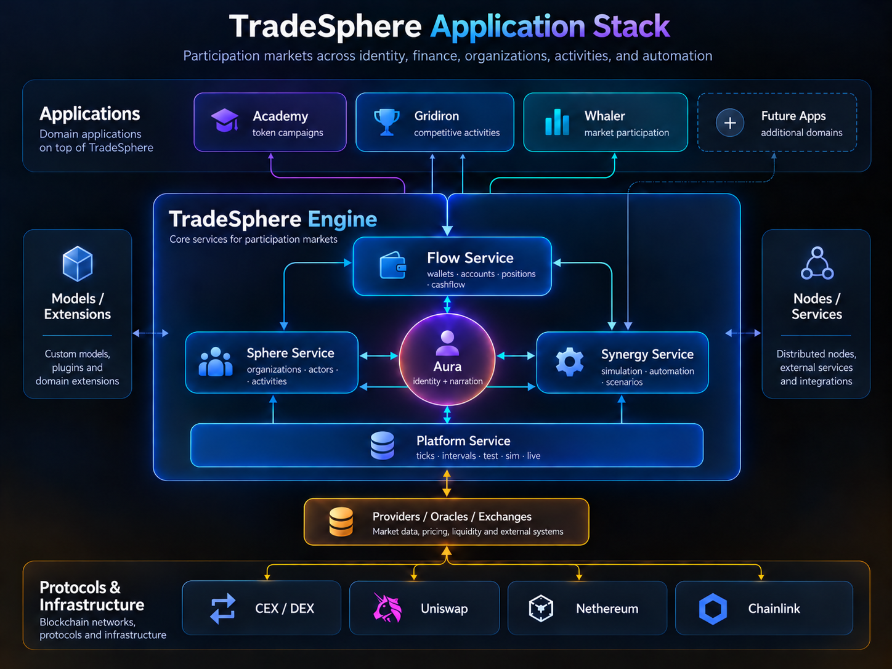

# TradeSphere

### Participation Markets for Humans and Autonomous Agents

**Business, financial, gaming, and automation systems share a common problem: participation is fragmented across disconnected environments.**

People and autonomous agents operate within different systems, each with its own identities, rules, resources, incentives, and execution mechanisms.

Yet the underlying activities have much in common. Participants organize, make decisions, commit resources, pursue objectives, compete or cooperate, and experience consequences.

**TradeSphere brings these mechanics together through a shared architecture for participation markets.**

Rather than building isolated applications for every domain, TradeSphere provides common services for organizations, actors, activities, economic operations, and scenario-driven execution.

Applications can specialize in auctions, financial markets, games, or other activities while sharing the same underlying participation model.

**One architecture. Multiple domains. Human and machine participation.**

*TradeSphere applications, core services, domain extensions, and supporting infrastructure.*

---

## The Problem: Disconnected Participation Systems

Business systems manage organizations, accounts, transactions, and workflows.

Games manage players, resources, strategies, objectives, progression, and rewards.

Financial systems manage markets, capital, risk, and economic commitments.

Automation systems coordinate processes and increasingly autonomous participants.

These systems may serve different purposes, but they share many fundamental concepts.

| Common Element | Across Domains |
|---|---|
| **Participants** | People, teams, organizations, and autonomous agents |
| **Rules** | Permissions, conditions, constraints, and operating procedures |
| **Resources** | Capital, assets, information, time, and capabilities |
| **Activities** | Transactions, projects, missions, competitions, and games |
| **Decisions** | Strategies, signals, proposals, and commitments |
| **Incentives** | Rewards, reputation, compensation, and progression |
| **Consequences** | Economic outcomes, accountability, and changes in standing |

Despite these similarities, most systems implement their own participation models and execution infrastructure.

This makes it difficult to coordinate activities across domains, maintain portable participation history, or integrate human and autonomous decision-making.

### A Common Participation Model

TradeSphere approaches these domains as different forms of structured participation.

Organizations establish activities. Actors participate through directives and actions. Resources are committed, events are evaluated, and outcomes influence future participation.

The fundamental structure is:

**Organization → Activity → Directive → Action**

An Idea, a Mission, a Game, and an Auction can use the same participation architecture while applying different rules and economic mechanisms.

TradeSphere's objective is to make these activities interoperable without eliminating their individual characteristics.

**Treat serious economic and operational activity with the same structural clarity found in well-designed games: participants, rules, incentives, resources, strategy, progression, and consequences.**

---

## TradeSphere Architecture

The **TradeSphere Engine** provides a common execution environment built around specialized services and shared domain models.

| Service | Responsibility |
|---|---|
| **Platform Service** | Runtime execution, timing, ticks, intervals, and Test/Sim/Live environments |
| **Sphere Service** | Organizations, actors, activities, and participation environments |
| **Aura** | Identity, reputation, actor history, and narration |
| **Flow Service** | Wallets, accounts, positions, assets, and financial operations |
| **Synergy Service** | Scenarios, automation, directives, actions, and coordinated execution |

These services support different application domains without requiring each application to implement its own complete participation infrastructure.

### Organizations, Actors & Activities

Organizations provide environments where participants coordinate around shared objectives.

**Actors** represent human or automated participants.

**Activities** define structured environments in which Actors pursue objectives under established rules.

**Directives** coordinate decisions and commitments within activities.

**Actions** represent the work, transactions, or behaviors performed by participants.

This structure supports cooperative, competitive, and economic interactions using a common execution model.

### Scenario-Driven Execution

TradeSphere supports defining and executing scenarios that coordinate activities and automated participants.

The execution architecture supports three environments:

| Environment | Purpose |
|---|---|
| **Test** | Accelerated evaluation through mock execution |
| **Sim** | Simulation and validation under configured conditions, including testnet execution where applicable |
| **Live** | Operational execution involving actual participants and resources |

The same general execution model can be used to evaluate activities before deploying them into operational environments.

**TradeSphere already runs Ideas, Missions, and Games using its scenario and bot infrastructure.**

These are existing capabilities, not merely proposed architectural concepts.

### Extensibility & Integration

The platform architecture also provides for:

- Custom domain models and extensions
- Distributed nodes and services
- External market data and pricing providers
- Blockchain protocols and smart contracts
- Exchange and liquidity integrations
- Interfaces for independent autonomous agents

Some of these capabilities are operational, while others remain under development.

The objective is a composable architecture that can incorporate additional domains and external systems without replacing the underlying participation model.

---

## Applications

TradeSphere applications provide specialized experiences built around the platform's common architectural concepts.

### TradeSphere Academy — Token Auctions

**Working application**

TradeSphere Academy provides on-chain token auctions using **Uniswap's Continuous Clearing Auction (CCA)** protocol.

Academy includes:

- Connected-wallet bidding and transaction authorization
- Real-time auction monitoring and visualization
- Continuous clearing and token-flow displays
- Bid and position management
- Settlement and claims
- Scenario-driven testing and simulation
- Controlled test bots and execution replay

Its inaugural campaign, **Gridiron: The Reckoning**, begins with Discovery on Ethereum Sepolia and is designed to progress conditionally into mainnet auction stages.

Academy is operational as a standalone application. Auction creation, testing, automation, and administration are implemented but currently restricted.

**[Explore Academy](https://github.com/TradeSphere-org/TradeSphere-Academy-Public)** — Application overview, architecture, auction mechanics, and technical documentation.

### Gridiron — Competitive Participation

**Public preview**

Gridiron explores structured competition through leagues, teams, games, and community activities.

It applies TradeSphere's participation concepts to game-oriented environments involving objectives, strategy, progression, and rewards.

The application experience is accessible through the public TradeSphere preview.

Additional blockchain and smart contract integration remains in development.

### Whaler — Markets & Strategy

**Public preview**

Whaler explores market participation through Ideas, Missions, signals, collaborative strategies, and economic activities.

Its activity model provides a foundation for coordinating participation around market information, strategies, and decisions.

The application experience is available in the public TradeSphere preview, with additional blockchain integration planned.

### Beyond Individual Applications

Academy, Gridiron, and Whaler demonstrate different participation domains.

Their long-term architectural relationship is based on shared Actors, Activities, Directives, Actions, and supporting services rather than isolated application-specific participation models.

The applications remain at different stages of integration and public availability.

---

## Humans, Bots & Autonomous Agents

TradeSphere is designed to support both human and automated participation.

These participants may perform similar actions within an activity, but their identities, decision-making processes, and operating responsibilities can differ.

Three categories are particularly relevant:

| Participant | Role |
|---|---|
| **Human Actors** | Individuals participating directly through supported application interfaces |
| **TradeSphere Bots** | System-managed automated participants executing configured scenarios and activities |
| **External Agents** | Independently operated agents interacting through supported interfaces and protocols |

TradeSphere already uses bots to execute Ideas, Missions, and Games.

Academy extends the behavioral simulation model with configurable bidding strategies, personality-inspired profiles, temperaments, and behavioral parameters.

These enhancements can be carried into TradeSphere's existing scenario infrastructure.

Broader independent-agent participation, Aura identities, and distributed interfaces remain areas of continuing development.

### Identity & Reputation

The planned Aura integration extends participant identity beyond a single application or activity.

Its architecture encompasses identity, reputation, and persistent actor history.

The objective is for participation and demonstrated behavior to contribute to an Actor's standing over time.

The broader identity and reputation model remains under development and should not be confused with the identifiers currently used by existing application bots.

---

## Technology & Engineering

TradeSphere combines .NET application development, blockchain integration, and custom scenario-driven infrastructure.

| Technology | Role |
|---|---|
| **Microsoft .NET / Blazor** | Application framework, interactive interfaces, and services |
| **Fluent UI Blazor** | Component framework and design system |
| **Nethereum** | Ethereum smart contract integration for .NET |
| **Uniswap CCA** | On-chain auction execution and price discovery in Academy |
| **Reown** | Browser wallet connectivity and transaction authorization |
| **Ethereum / EVM** | Blockchain and smart contract infrastructure |
| **Microsoft Azure** | Application hosting and infrastructure |
| **GitHub** | Source management and technical documentation |

The platform also includes TradeSphere's own domain models, execution services, automation framework, and scenario infrastructure.

The architecture is intended to support both centralized application services and decentralized economic interactions, using blockchain where verifiable ownership, transactions, or settlement are required.

### Engineering Approach

Our development approach emphasizes:

- **Shared domain models:** Common representations for participation across different application domains.
- **Scenario-driven validation:** Evaluate behavior before committing to live execution.
- **Observable execution:** Monitor, reconstruct, and verify activity outcomes.
- **Composable services:** Extend the platform without rebuilding its core infrastructure.
- **Independent participation:** Support organizations and Actors without making centralized ownership a prerequisite.
- **Established protocols:** Integrate existing technologies where they provide effective foundations.

---

## Development Direction

TradeSphere is an evolving platform supported by an existing software implementation.

Development spans several related efforts:

| Area | Direction |
|---|---|
| **Academy** | Continue auction development and integrate auctions into TradeSphere Activities |
| **Aura** | Complete identity, reputation, and persistent actor history |
| **Flow** | Extend wallet, financial, and asset-management capabilities |
| **Synergy** | Expand automation, scenario execution, and behavioral modeling |
| **Gridiron & Whaler** | Extend public previews and blockchain integration |
| **TradeSphere Node / MCP** | Develop interfaces for external systems and autonomous agents |

These efforts are at different stages of completion.

The current platform already operates scenarios, activities, bots, and publicly accessible application previews. Full integration of all services and external-agent capabilities remains ongoing work.

---

## Where's the Code?

TradeSphere is backed by a substantial working software implementation.

Our primary application and platform development repositories remain private while we establish a public GitHub presence for technical documentation, architecture, and demonstrations.

**TradeSphere Academy** is the first project being presented through a dedicated public-facing documentation repository.

Selected libraries, components, and integration interfaces may be released separately as they become ready.

**The software is operational. The source is private for now. The engineering is open for discussion.**

---

## Explore TradeSphere

**[TradeSphere Website](https://www.tradesphere.org)** — The ecosystem, applications, and project information.

**[TradeSphere Academy on GitHub](https://github.com/TradeSphere-org/TradeSphere-Academy-Public)** — On-chain auctions, implementation architecture, and technical documentation.

**[TradeSphere App](https://app.tradesphere.org)** — Live public preview of the TradeSphere platform, including Gridiron and Whaler.

**[X — @tradesphereinfo](https://x.com/tradesphereinfo)** — Project updates and announcements.

**[Discord](https://discord.gg/QkJqp4snHQ)** — Community and technical discussion.

**Contact:** [info@tradesphere.com](mailto:info@tradesphere.com)

---

## Get Involved

TradeSphere is being developed as an extensible platform for economic participation across multiple domains.

We're interested in connecting with developers, researchers, project builders, and organizations working on:

- Decentralized markets and blockchain infrastructure
- Autonomous agents and interoperable identity
- Economic modeling and incentive systems
- Simulation, automation, and scenario-driven execution
- Gaming, competition, and collaborative participation
- Distributed systems and application architecture

We welcome technical feedback, implementation discussions, ideas for integration, and opportunities for collaboration.

Our goal is to work with people and organizations whose interests and capabilities align with what we're building.

**Explore the applications, review the architecture, and get in touch if you see an opportunity to build something useful together.**

---

**TradeSphere™ — Participation Markets for Humans and Autonomous Agents.**
